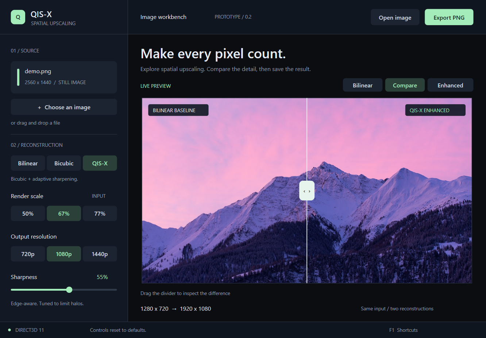

# QIS-X
### Quality Intelligent Scaling — Extended

A native Windows workbench for experimenting with lightweight image upscaling. Open an image, compare bilinear interpolation with bicubic reconstruction and adaptive sharpening, then export the result.



**Status: working image prototype (v0.2).** Live game capture and temporal upscaling are future milestones.

## Try it

If you have the built project, open `out/build/windows/Release/QIS-X.exe`. The app starts with the bundled mountain image and also accepts an image path on the command line.

- Open PNG, JPEG, BMP, or TIFF images, or drag a file into the window.
- Switch between **Bilinear**, **Bicubic**, and **QIS-X** (bicubic + adaptive sharpening).
- Choose **50%, 67%, or 77%** render scale and **720p, 1080p, or 1440p** output.
- Drag the divider to compare both reconstructions from the same low-resolution input.
- Adjust sharpening and **Export PNG** at the selected output resolution.

Export always saves the enhanced result without the interface or comparison divider. Image aspect ratio is preserved with letterboxing when needed.

## Build

Requires **Windows 10/11**, **Visual Studio 2022** with **Desktop development with C++** and a Windows SDK, and **CMake 3.25+**. No NuGet packages, third-party downloads, or DirectX Toolkit installation are needed.

From PowerShell in this folder:

```powershell
.\build.cmd
```

Or run the commands directly:

```powershell
cmake --preset windows
cmake --build --preset release --parallel
ctest --preset release
.\out\build\windows\Release\QIS-X.exe
```

The tests use Windows' software renderer and produce preview images in `out/build/windows/test-artifacts/`. Visual Studio can also open the folder directly and use its CMake integration.

In VS Code, use **Ctrl+Shift+B** to build the project and **F5** to run it with the Windows debugger. The workspace uses CMake Tools for C++ IntelliSense. If clangd is enabled, its configuration reads the compiler flags generated by `cmake --preset windows`; configure the project once after opening the folder. Build the complete CMake target instead of compiling an individual `.cpp` file with Code Runner.

To make a portable folder after building:

```powershell
cmake --install out/build/windows --config Release --prefix out/package/QIS-X
```

Keep `QIS-X.exe` and `assets/demo.png` together. Shaders are embedded in the executable, and assets resolve relative to the executable rather than the working directory. If the demo asset is absent, a built-in resolution chart appears.

## Keyboard controls

| Shortcut | Action |
| --- | --- |
| Ctrl+O / Ctrl+S | Open image / export PNG |
| 1 / 2 / 3 | Bilinear / Bicubic / QIS-X |
| B | Cycle comparison views |
| Left / Right | Move the comparison divider |
| + / - | Adjust sharpness |
| P / O | Cycle render scale / output resolution |
| D / R | Load demo / reset controls |
| F1 | Show shortcuts and graphics adapter |

## What this prototype demonstrates

A complete image-to-GPU-to-PNG spatial reconstruction pipeline with adjustable filtering, a fair comparison, resize/DPI support, and hardware rendering with a WARP software fallback. UI FPS measures display presentation; it is not a game benchmark.

See [prototype notes](docs/PROTOTYPE.md) for architecture, validation, limits, and the path toward live capture.
